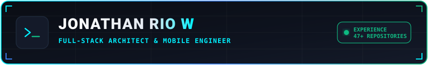

  <!-- Self-Hosted SVG Banner (CDN GitHub, zero cold-start) -->
  

  <!-- Dynamic Typing Subtitle -->
  

   

  <!-- Status Badges -->
  
  &nbsp;
  
  &nbsp;
  

<!-- ======================== BENTO GRID (PURE HTML) ======================== -->

<table>
<tr>
<td width="50%" valign="top">

<!-- ======= LEFT COLUMN: Character HUD + Tech Arsenal ======= -->

<h3>📜 Character Status Sheet</h3>

<table>
<tr><td>🛡️ <b>Adventurer</b></td><td>Jonathan Rio W (<a href="https://github.com/JoRioW">@JoRioW</a>)</td></tr>
<tr><td>⚔️ <b>Class</b></td><td>Full-Stack Architect & Mobile Engineer</td></tr>
<tr><td>⚡ <b>Level</b></td><td>47+ Repositories Crafted</td></tr>
<tr><td>🎒 <b>Primary</b></td><td>Laravel (Blade/PHP) • Java (Spring/Android)</td></tr>
<tr><td>🏹 <b>Mobile</b></td><td>Kotlin • Dart (Flutter)</td></tr>
<tr><td>💾 <b>Stack</b></td><td>TypeScript/JS • React • MySQL • MongoDB</td></tr>
<tr><td>✨ <b>Passives</b></td><td>Clean Architecture • High Shipping Velocity</td></tr>
<tr><td>📍 <b>Realm</b></td><td>Indonesia 🇮🇩</td></tr>
</table>

 

<h3>🎒 Equipped Arsenal</h3>

<b>⚔️ Languages:</b>  

<b>🛡️ Frameworks & Forge:</b>  

</td>
<td width="50%" valign="top">

<!-- ======= RIGHT COLUMN: Campaigns + Snake + Streak ======= -->

<h3>🗺️ Active Campaigns</h3>

<ul>
<li>🏢 <b><a href="https://github.com/JoRioW">UnityWork Suite & Zenit Finance</a></b> Enterprise ERP & Financial Engine — Laravel, Blade, MySQL</li>
<li>🛒 <b><a href="https://github.com/JoRioW">Casiran POS Platform</a></b> Multi-Store Retail & Point-of-Sale — PHP, MySQL, APIs</li>
<li>🚗 <b><a href="https://github.com/JoRioW/Rentalin">Rentalin & Mobile Apps</a></b> Native Android Applications — Java, Kotlin, Android Studio</li>
<li>💳 <b><a href="https://github.com/JoRioW">Payment Gateway & Microservices</a></b> MERN Payment Processing & Java Spring Cloud Services</li>
</ul>

<h3>🎮 Contribution Snake Eater</h3>

<picture>
<source media="(prefers-color-scheme: dark)" srcset="https://raw.githubusercontent.com/JoRioW/JoRioW/output/github-contribution-grid-snake-dark.svg" />
<source media="(prefers-color-scheme: light)" srcset="https://raw.githubusercontent.com/JoRioW/JoRioW/output/github-contribution-grid-snake.svg" />

</picture>

<h3>📊 Battle Streak & Guild Links</h3>

  

&nbsp;

</td>
</tr>
</table>

<i>Crafted with precision • 1-Screen Gamified Bento HUD • Auto-updated daily ⚡</i>

